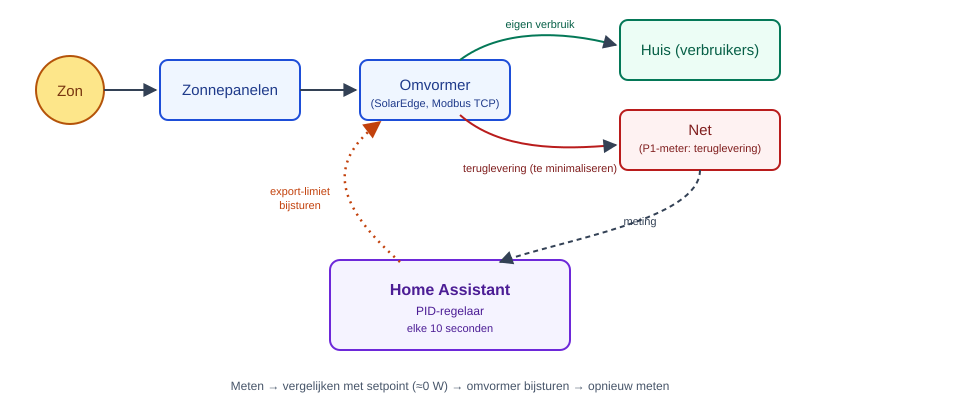
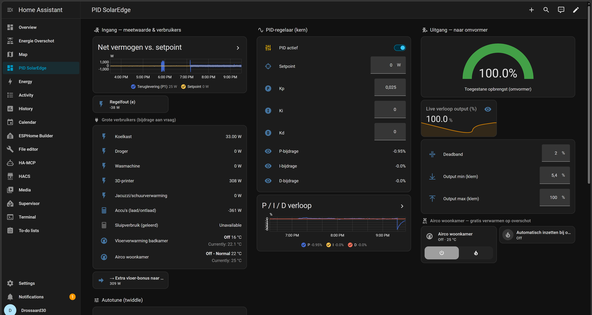

# PID-gestuurde zero-export regeling voor SolarEdge + Home Assistant

**Zet je zonnepanelen niet uit — regel ze fijn.**

Een Home Assistant-automatisering die de export-limiet van een SolarEdge-omvormer elke 10 seconden bijstuurt met een PID-regelaar, zodat de teruglevering aan het net zo dicht mogelijk bij 0 W blijft. In plaats van de installatie helemaal stil te leggen zodra er overschot is (wat je nu al mensen ziet doen), blijft de omvormer zoveel mogelijk zelf opgewekte stroom direct bruikbaar maken.

## Waarom dit project

Per **1 januari 2027** stopt de salderingsregeling in Nederland definitief. Stroom die je teruglevert aan het net wordt dan niet meer verrekend tegen je eigen verbruik, en de vergoeding die je ervoor krijgt zakt naar een fractie van het kale stroomtarief. Teruglevering gaat dus geld kosten in plaats van niets.

Veel huishoudens reageren daar nu al op door hun omvormer gewoon uit te zetten zodra er overschot is — dat is zonde, want je gooit dan opbrengst weg die je prima zelf had kunnen gebruiken. Dit project regelt in plaats daarvan de omvormer continu bij, zodat je altijd zoveel mogelijk van je eigen opwek blijft benutten en alleen het exacte teveel wordt teruggeregeld.

Niet iedereen heeft een thuisaccu om overschot in op te slaan. Deze aanpak werkt ook zonder accu: de regelaar stuurt rechtstreeks de opwek van de omvormer bij op basis van wat de slimme meter op dat moment ziet.

## Hoe het werkt

1. **Meten** — elke 10 seconden wordt het actuele terugleververmogen gelezen (via een slimme meter, in dit voorbeeld een P1-meter).
2. **Vergelijken** — dat wordt vergeleken met het doel: zo dicht mogelijk bij 0 W teruglevering (instelbaar).
3. **Bijsturen** — op basis van het verschil wordt de export-limiet van de omvormer iets opgehoogd of verlaagd.

Dit gebeurt met een **PID-regelaar** — dezelfde regeltechniek die in bijvoorbeeld cruise control en thermostaten wordt gebruikt. Hij reageert niet alleen op de afwijking van dit moment (P), maar ook op hoe lang die al bestaat (I) en hoe snel hij verandert (D). Dat voorkomt slingeren (steeds te hard overcorrigeren) en zorgt voor een soepele regeling.

Een **deadband** (standaard 2%) voorkomt dat er bij elke kleine schommeling naar de omvormer wordt geschreven — pas als de gewenste bijstelling groter is dan die marge, wordt de nieuwe limiet echt weggeschreven.

## Benodigdheden

| Onderdeel | In dit voorbeeld | Waarom nodig |
|---|---|---|
| Omvormer met lokaal aanstuurbare export-limiet | SolarEdge SE-serie via de `solaredge_modbus`-integratie (Modbus TCP, lokaal netwerk) | Om de opwek daadwerkelijk te kunnen bijsturen |
| Slimme meter, (bijna) realtime uitleesbaar | HomeWizard P1-meter | Om te weten hoeveel er op dit moment wordt teruggeleverd |
| Home Assistant | — | Om de regellus te draaien |
| Thuisaccu | optioneel | Niet vereist — dit werkt ook zonder, de regelaar grijpt dan direct in op de omvormer |

Werkt je omvormer niet via Modbus TCP met SolarEdge-registers? Dan moet je alleen de actie die de export-limiet wegschrijft (`number.set_value` in de automatisering) vervangen door de service-aanroep die bij jouw merk/integratie hoort — de rest van de regellogica blijft hetzelfde.

## Installatie

1. Zorg dat je omvormer lokaal bereikbaar is via Modbus TCP en de `solaredge_modbus`-integratie (of het equivalent voor jouw merk) in Home Assistant draait. Je hebt dan een entiteit zoals `number.<omvormer>_active_power_limit` die 0–100% export-limiet accepteert.
2. Zorg voor een sensor met het actuele netto vermogen op je aansluiting (positief = afname, negatief = teruglevering) — bijvoorbeeld via de HomeWizard-integratie.
3. Kopieer `package_pid_core.yaml` naar je `packages`-map (of voeg de inhoud toe aan je `configuration.yaml`) en pas de entity-ID's in de `sensor.pid_fout`-template en de automatisering aan naar jouw eigen meter- en omvormer-entiteiten.
4. Herstart Home Assistant (of herlaad automatiseringen/template-helpers) en zet `input_boolean.pid_solaredge_actief` aan.
5. Begin met een hoge deadband en bescheiden Kp/Ki/Kd, en bouw die rustig op terwijl je het gedrag volgt — zet de regelaar niet meteen los op "actief" zonder een paar uur te hebben meegekeken.
6. Optioneel: `package_pid_extra.yaml` bevat uitbreidingen (zelf-tunende parameters, een geleerd basisverbruik, en overschot gebruiken om bijvoorbeeld een airco gratis te laten verwarmen) — dit zijn bouwstenen die per huishouden aangepast moeten worden aan de eigen apparaten, geen plug-and-play onderdelen.
7. `dashboard_pid_zonne_regeling.yaml` is een voorbeeld-dashboard (Home Assistant *sections*-view) om alles in één oogopslag te volgen.

## Dashboard

## Verwant werk

Dit idee van "zero export" via Home Assistant bestaat al in verschillende merk-specifieke vormen, meestal met een eenvoudige P- of PI-regeling:

- [Solakon ONE Zero Export Control](https://community.home-assistant.io/t/solakon-one-zero-export-control-dynamic-nulleinspeisung-zero-export-with-soc-logic/944273)
- [Anker SOLIX 4 Pro — Local Zero Export](https://community.home-assistant.io/t/anker-solix-4-pro-local-zero-export-with-eco-mode-hardware-protection/1021836)
- [SolarEdge Modbus change export limit (openHAB)](https://community.openhab.org/t/solaredge-modbus-change-export-limit/152363)

Dit project voegt daar een volledige, zelf-tunende PID-regelaar aan toe, specifiek voor SolarEdge via Modbus TCP, plus het nuttig inzetten van overschot in plaats van het alleen maar weg te regelen.

## Status / bekende beperkingen

- Getest op één SolarEdge SE3500H met een HomeWizard P1-meter — andere merken/modellen vragen aanpassing van de schrijf-actie.
- Er zit geen expliciete snelheids- of frequentielimiet op het schrijven naar de omvormer buiten de deadband — controleer wat jouw omvormer/fabrikant acceptabel vindt qua schrijffrequentie.
- De uitbreidingen in `package_pid_extra.yaml` zijn specifiek voor de apparaten van de auteur en dienen als voorbeeld, niet als kant-en-klare oplossing.

## Licentie

MIT — gebruik, pas aan en deel vrij. Geen garanties; test rustig op lage impact-instellingen voordat je de regelaar loslaat.
